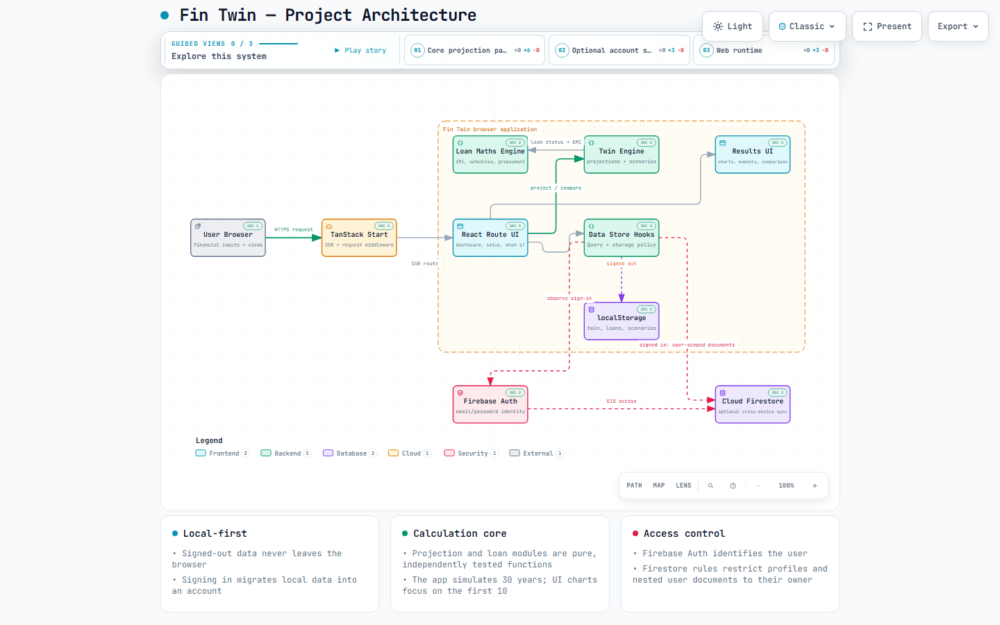
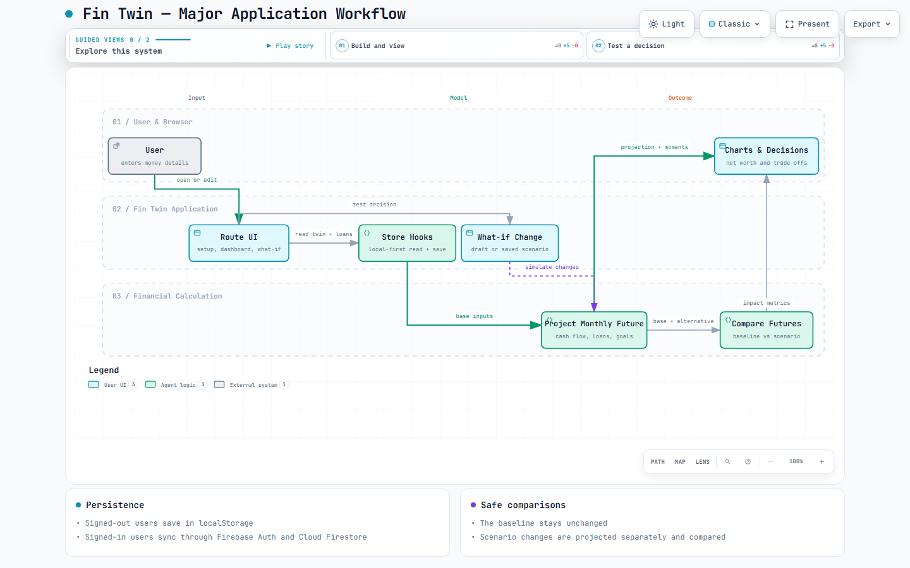

# Fin Twin

> Test money decisions on your financial twin before making them in real life.

## Platform video

https://github.com/user-attachments/assets/f005f1f3-f2fc-449b-aa64-b2356cc51544

<sub><b>25 s · 1080p · with sound.</b> From everyday money decisions to your financial twin, projections, and what-if comparisons. Video not playing? <a href="docs/media/fin-twin-demo.mp4">Download the video</a>.</sub>

---

Fin Twin is a local-first personal-finance planning application for salaried people in India. It turns a small set of self-entered numbers—income, spending, savings, investments, loans, EMIs, and goals—into a month-by-month financial projection. Use it to understand your current trajectory, then safely explore decisions such as financing a car, increasing a SIP, taking a career break, changing jobs, moving city, or prepaying a loan.

There is no bank connection. The app only works with numbers the user enters, and it is not financial advice or a prediction.

## What it does

- Builds a financial twin from monthly income, expenses, cash, investments, SIP contributions, goals, assumptions, and loans.
- Projects cash flow, net worth, debt, goals, and financial-cushion signals over a 30-year horizon; the dashboard focuses on the first 10 years.
- Calculates EMIs, repayment schedules, outstanding balances, interest/principal splits, and prepayment trade-offs.
- Lets users run non-destructive what-if scenarios and compare them against the baseline future.
- Keeps data in browser `localStorage` by default, with optional Firebase account sync across devices.
- Exports entered data as JSON and supports permanent deletion of local and synced data.

## Architecture preview

The architecture shows the browser application, TanStack Start runtime, React route layer, local-first store, pure financial engines, and the optional Firebase sync path.

[Interactive architecture diagram (HTML)](docs/financial-monitor.architecture.html)



## Workflow preview

The workflow covers the main path from financial input to dashboard results, plus the branch that simulates and compares a what-if decision without changing the baseline.

[Interactive workflow diagram (HTML)](docs/financial-monitor.workflow.html)




The editable Archify specifications are available in [docs/financial-monitor.architecture.json](docs/financial-monitor.architecture.json) and [docs/financial-monitor.workflow-preview.json](docs/financial-monitor.workflow-preview.json).

## How it works

1. **Enter a financial picture.** Add take-home pay, normal spending, savings, investments, SIP contributions, goals, assumptions, and loans.
2. **Model the baseline.** The projection engine simulates each month: income rises annually according to the selected raise assumption, expenses rise with inflation, loans accrue interest and receive EMIs, cash earns interest, and investments grow at the selected return rate.
3. **Identify meaningful moments.** The app surfaces such events as an EMI ending, a goal being funded late, cash cushion dropping, debt becoming zero, or money running out.
4. **Test a decision.** A what-if applies one or more changes to a copy of the baseline: purchase with cash or financing, income change, spending change, SIP change, or loan prepayment.
5. **Compare the futures.** Fin Twin reports changes to monthly free cash, five- and ten-year net worth, goal dates, debt-free date, minimum cushion, and cash-shortfall timing.

## Data and privacy

Fin Twin is local-first:

- **Signed out:** data is stored only in the current browser under `fintwin.twin.v1`, `fintwin.loans.v1`, and `fintwin.scenarios.v1`.
- **Signed in:** Firebase Authentication identifies the user and Cloud Firestore stores user-scoped documents. The app migrates locally entered data to the account after sign-in.
- **Access control:** Firestore rules restrict `profiles/{uid}` and `users/{uid}/…` records to their owning authenticated user.
- **Control:** Settings can export the current data to JSON or delete the data, with an option to delete the Firebase account too.

## Technology

| Area | Implementation |
| --- | --- |
| Application runtime | TanStack Start, React 19, Vite, SSR |
| Routing and server handling | TanStack Router, Start middleware, custom SSR error fallback |
| Client state | TanStack Query and custom local-first hooks |
| Financial logic | Pure TypeScript modules for projections and loan calculations |
| UI | Tailwind CSS v4, Base UI/shadcn components, Recharts, Lucide, Sonner |
| Optional sync | Firebase Auth and Cloud Firestore |
| Deployment target | Cloudflare Workers through Nitro |

## Project structure

```text
src/
  routes/                    File-based screens: dashboard, setup, loans, what-if, settings, auth
  hooks/use-store.ts         Local-first data access, Firebase sync, export, deletion, migration
  hooks/use-auth.ts          Firebase authentication state
  lib/twin.ts                Monthly financial projection and scenario comparison
  lib/loans.ts               EMI, amortization, schedules, status, and prepayment calculations
  lib/calendar.ts            EMI calendar export
  components/fintwin/        Feature UI, charts, loan form, moments, and auth layout
  components/ui/             Reusable design-system components
  integrations/firebase/     Firebase client initialization
  start.ts / server.ts       Start middleware and SSR server entry
firestore.rules              Owner-only access rules for synced data
docs/                        Interactive Archify diagrams and their source specifications
```

## Disclaimer

Fin Twin is a planning and comparison tool based on user-provided assumptions. It does not connect to financial institutions, execute transactions, or provide investment, tax, lending, or financial advice.
